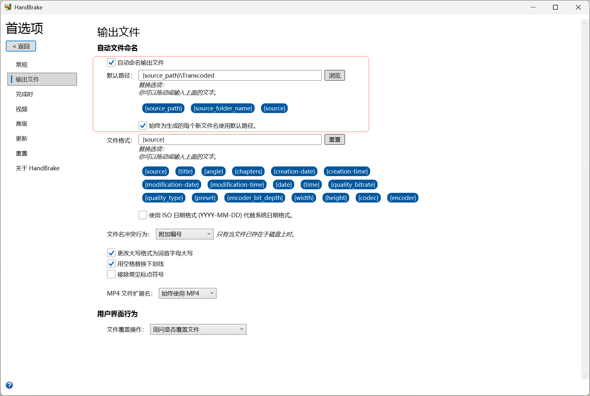
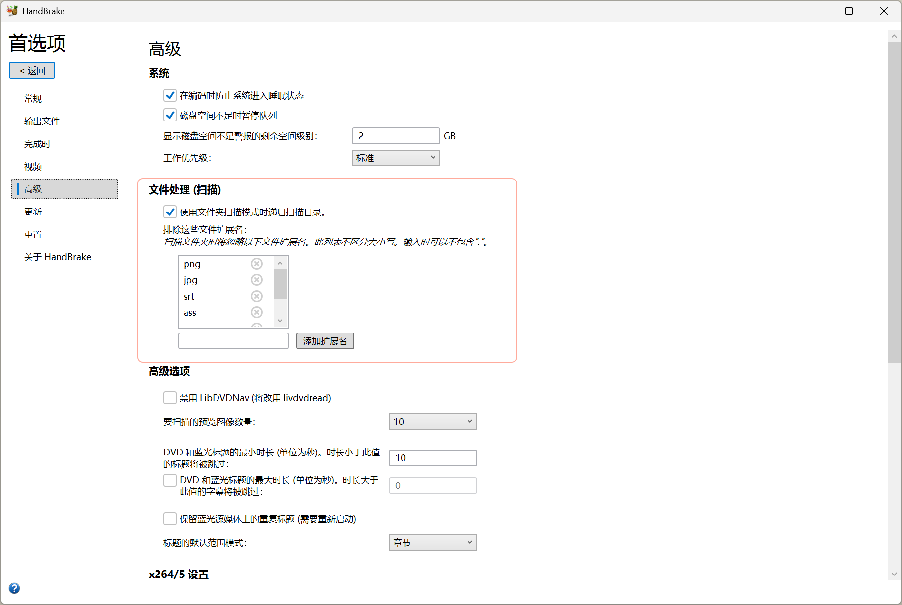

# HandBrake 批量转码操作步骤（保留目录结构）

**工具下载**

- 图形界面版：[handbrake.fr/downloads.php](https://handbrake.fr/downloads.php)
- 命令行版 HandBrakeCLI：[handbrake.fr/downloads2.php](https://handbrake.fr/downloads2.php)
- 源码仓库：[github.com/HandBrake/HandBrake](https://github.com/HandBrake/HandBrake)

适用场景：一个总目录下有多个子目录，每个子目录里放着视频。用 HandBrake 自带的「递归扫描」+
「自动文件命名」，把成品转进同目录下的 `Transcoded` 文件夹；转码完成后再用一段 PowerShell 收尾。

---

## 一、一次性设置（只需改两处）

### 1. 默认输出路径

**工具 → 首选项 → 输出文件**，把 **默认路径：** 填成：

```
{source_path}\Transcoded
```

模板替换项：`{source_path}` 源文件所在文件夹、`{source_folder_name}` 该文件夹的名字、`{source}` 源文件名。

「自动命名输出文件」和「始终为生成的每个新文件名使用默认路径」默认已勾选，不用动。

另外建议取消这两项，否则成品文件名会被改写（不影响脚本判断，只影响你最终看到的文件名）：

- 更改大写格式为词首字母大写
- 用空格替换下划线



对照要点：默认路径是 `{source_path}\Transcoded`，上面两项均为勾选，文件格式为 `{source}`。

### 2. 打开递归扫描

**工具 → 首选项 → 高级**，在 **文件处理 (扫描)** 区块勾选 **使用文件夹扫描模式时递归扫描目录。**

这个开关默认关闭，不勾就只会扫描选中的那一层，子文件夹里的视频不会进队列。



对照要点：递归扫描已勾选；排除扩展名列表（png、jpg、srt、ass）只影响非视频文件。

保存退出，其余选项保持默认。

---

## 二、每次批量转码

1. 工具栏 **打开源文件**，选择**总目录**（不是单个视频）。
2. 递归扫描后弹出 **源选择** 窗口，逐个列出子目录中的视频。
3. 点 **添加全部（所选）** 加入队列。
4. 点 **开始编码**，等队列跑完。

成品写在各自目录下的 `Transcoded` 子目录里。

---

## 三、收尾（两种方式，二选一）

脚本处理的是**当前所在目录**：先 `cd` 到总目录，整段粘贴，回车即可运行，不用改任何一行。

判断依据是**数量**而不是文件名：对每个含 `Transcoded` 的目录，比较「该目录下的源视频数」和
「`Transcoded` 里的非空视频数」，相等才处理，不相等就跳过并在最后列出来。所以 HandBrake 怎么
给成品改名都不影响。

**脚本不删除任何文件**，只是把源视频移动到总目录下的 `_Originals` 里，并保持原子目录结构；
确认没问题后，`_Originals` 留还是删由你自己决定。列出清单后输入 `y` 才执行，其它内容取消。

### 3.1 方案 A：成品提回原位，并删除空的 `Transcoded` 目录

执行顺序：**源视频移到 `_Originals` → 成品全部移到上一层 → 删除空的 `Transcoded`**。
中间不比对文件名，所以不会出现成品和原片混在一起。

```powershell
$root = (Get-Location).Path
"处理目录: $root"
$hold = Join-Path $root '_Originals'
$videoExt = '.mp4', '.m4v', '.mkv', '.avi', '.mov', '.wmv', '.flv', '.ts', '.m2ts', '.webm', '.mpg', '.mpeg', '.vob'

$ok = @(); $skip = @()
Get-ChildItem $root -Recurse -Directory -Filter Transcoded | ForEach-Object {
    $sub  = $_.FullName
    $base = Split-Path $sub -Parent
    $src  = @(Get-ChildItem -LiteralPath $base -File | Where-Object { $_.Extension -in $videoExt })
    $enc  = @(Get-ChildItem -LiteralPath $sub  -File | Where-Object { $_.Extension -in $videoExt -and $_.Length -gt 0 })
    if ($src.Count -gt 0 -and $src.Count -eq $enc.Count) {
        $ok   += [pscustomobject]@{ 基目录 = $base; 成品目录 = $sub; 数量 = $src.Count }
    } else {
        $skip += [pscustomobject]@{ 基目录 = $base; 源 = $src.Count; 成品 = $enc.Count }
    }
}

if ($ok.Count -eq 0) { '没有数量匹配的目录，未做任何修改。' }
else {
    $ok | ForEach-Object { "将处理: $($_.基目录)（$($_.数量) 个）" }
    $skip | ForEach-Object { "跳过: $($_.基目录)（源 $($_.源) / 成品 $($_.成品)）" }
    if ((Read-Host "共 $($ok.Count) 个目录，输入 y 执行，其它内容取消") -match '^[yY]$') {
        foreach ($item in $ok) {
            try {
                $rel = $item.基目录.Substring($root.Length).TrimStart('\')
                $dst = Join-Path $hold $rel
                New-Item -ItemType Directory -Path $dst -Force | Out-Null
                Get-ChildItem -LiteralPath $item.基目录 -File |
                    Where-Object { $_.Extension -in $videoExt } |
                    ForEach-Object { Move-Item -LiteralPath $_.FullName -Destination (Join-Path $dst $_.Name) -Force }
                Get-ChildItem -LiteralPath $item.成品目录 -File |
                    ForEach-Object { Move-Item -LiteralPath $_.FullName -Destination (Join-Path $item.基目录 $_.Name) }
                if (-not (Get-ChildItem -LiteralPath $item.成品目录 -Recurse -File)) {
                    Remove-Item -LiteralPath $item.成品目录 -Force
                    "完成: $($item.基目录)"
                } else { "保留（仍有文件未移走）: $($item.成品目录)" }
            } catch {
                "处理中断: $($item.基目录)（$($_.Exception.Message)）"
            }
        }
        "源视频已移至: $hold"
    } else { '已取消，未做任何修改' }
}
```

### 3.2 方案 B：成品留在 `Transcoded` 里，只移走源视频

```powershell
$root = (Get-Location).Path
"处理目录: $root"
$hold = Join-Path $root '_Originals'
$videoExt = '.mp4', '.m4v', '.mkv', '.avi', '.mov', '.wmv', '.flv', '.ts', '.m2ts', '.webm', '.mpg', '.mpeg', '.vob'

$ok = @(); $skip = @()
Get-ChildItem $root -Recurse -Directory -Filter Transcoded | ForEach-Object {
    $sub  = $_.FullName
    $base = Split-Path $sub -Parent
    $src  = @(Get-ChildItem -LiteralPath $base -File | Where-Object { $_.Extension -in $videoExt })
    $enc  = @(Get-ChildItem -LiteralPath $sub  -File | Where-Object { $_.Extension -in $videoExt -and $_.Length -gt 0 })
    if ($src.Count -gt 0 -and $src.Count -eq $enc.Count) {
        $ok   += [pscustomobject]@{ 基目录 = $base; 数量 = $src.Count }
    } else {
        $skip += [pscustomobject]@{ 基目录 = $base; 源 = $src.Count; 成品 = $enc.Count }
    }
}

if ($ok.Count -eq 0) { '没有数量匹配的目录，未做任何修改。' }
else {
    $ok | ForEach-Object { "将移走源: $($_.基目录)（$($_.数量) 个）" }
    $skip | ForEach-Object { "跳过: $($_.基目录)（源 $($_.源) / 成品 $($_.成品)）" }
    if ((Read-Host "共 $($ok.Count) 个目录，输入 y 执行，其它内容取消") -match '^[yY]$') {
        foreach ($item in $ok) {
            $rel = $item.基目录.Substring($root.Length).TrimStart('\')
            $dst = Join-Path $hold $rel
            New-Item -ItemType Directory -Path $dst -Force | Out-Null
            Get-ChildItem -LiteralPath $item.基目录 -File |
                Where-Object { $_.Extension -in $videoExt } |
                ForEach-Object { Move-Item -LiteralPath $_.FullName -Destination (Join-Path $dst $_.Name) -Force; "已移走: $($_.Name)" }
        }
        "源视频已移至: $hold"
    } else { '已取消，未做任何修改' }
}
```

### 3.3 两种方式的差别

| 对比项 | 方案 A | 方案 B |
| --- | --- | --- |
| 成品位置 | 源文件原来的位置 | `Transcoded` 子目录里 |
| 源视频 | 移到 `_Originals` | 移到 `_Originals` |
| `Transcoded` 目录 | 移空后删除 | 保留 |
| 目录结构 | 与原片一致，只留成品 | 多一层 `Transcoded` |
| 常见用途 | 转完直接替换素材库 | 先隔离存放，稍后整理 |

执行完用 `tree /f` 检查一遍。

---

## 四、注意事项

1. **数量相等不代表内容一一对应。** 如果 `Transcoded` 里残留了上次的 `名字(1).mp4`，数量可能凑巧对上。真遇到就在 `_Originals` 里找回原片重新转，源文件没有被删除。

2. **数量不等的目录一律跳过。** 说明有失败任务或漏转，先看队列日志，处理完再跑一次脚本。

3. **`_Originals` 保留相对路径**，例如 `_Originals\001\a.mp4` 对应原来的 `001\a.mp4`，方便对照。确认成品没问题后整个删掉即可；脚本重跑也不会把它当成源目录（里面没有 `Transcoded`）。

4. **确认只认 `y`，直接回车即取消。** 脚本没有需要修改的参数，粘贴即可运行。

5. **成品与源在同一棵目录树里是这个方案的取舍。** 想让成品落到独立磁盘并保持相对结构，官方界面做不到，需要改源码或自写脚本。

---

## 五、流程速查

```
首选项 → 输出文件 → 默认路径 {source_path}\Transcoded
首选项 → 高级     → 勾选「使用文件夹扫描模式时递归扫描目录」
打开源文件（总目录） → 源选择 → 添加全部（所选） → 开始编码
完成后（二选一）：cd 到总目录 → 整段粘贴脚本 → 输入 y
    A：源移入 _Originals → 成品提上来 → 删空 Transcoded
    B：源移入 _Originals，成品留在 Transcoded
最后确认成品，再决定是否删除 _Originals
```
